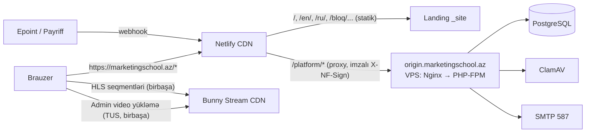
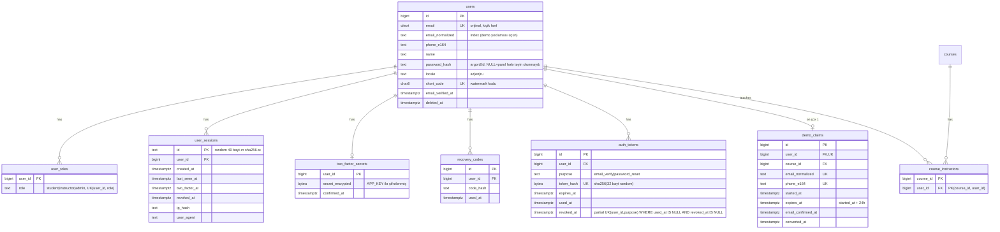
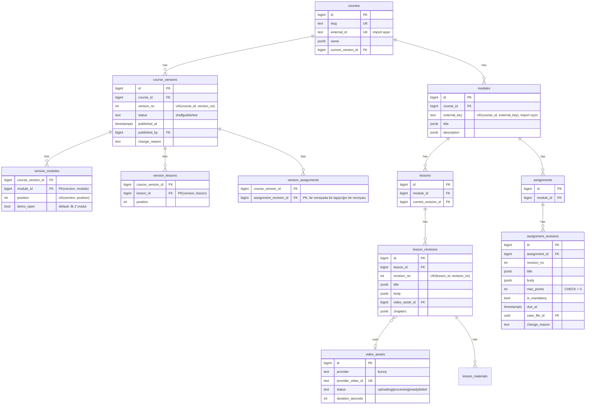
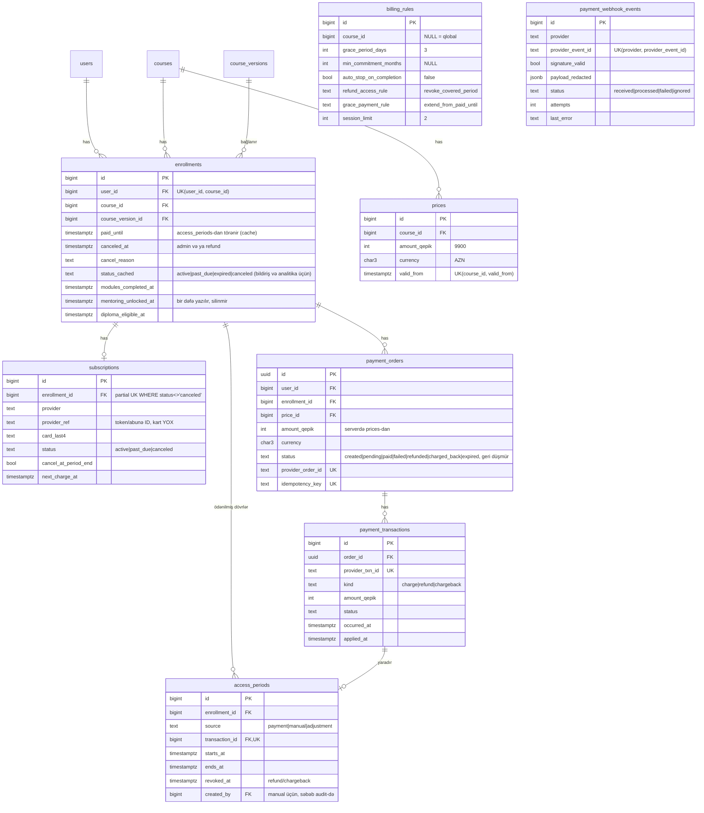
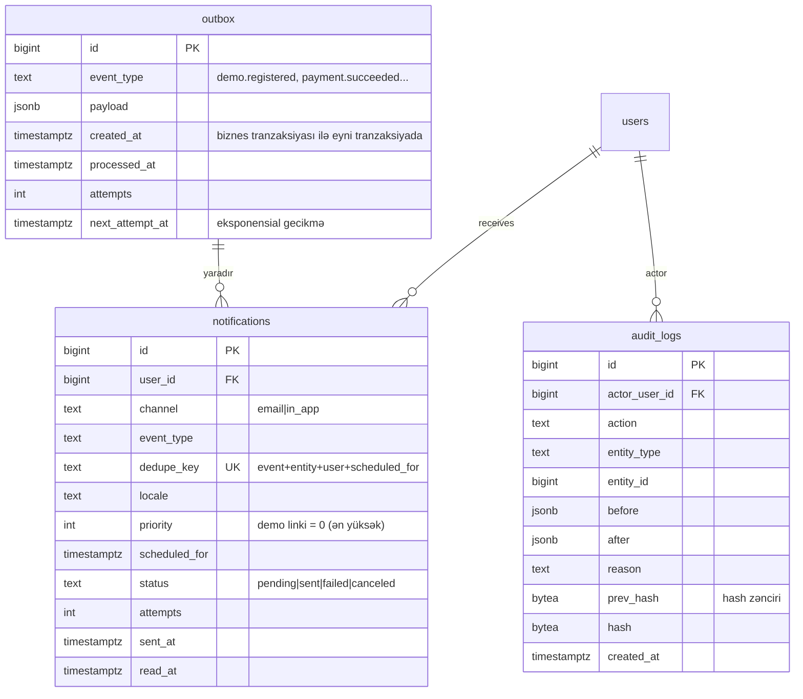
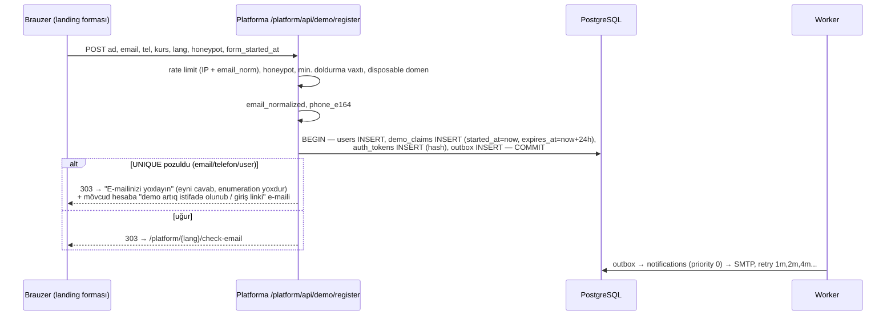
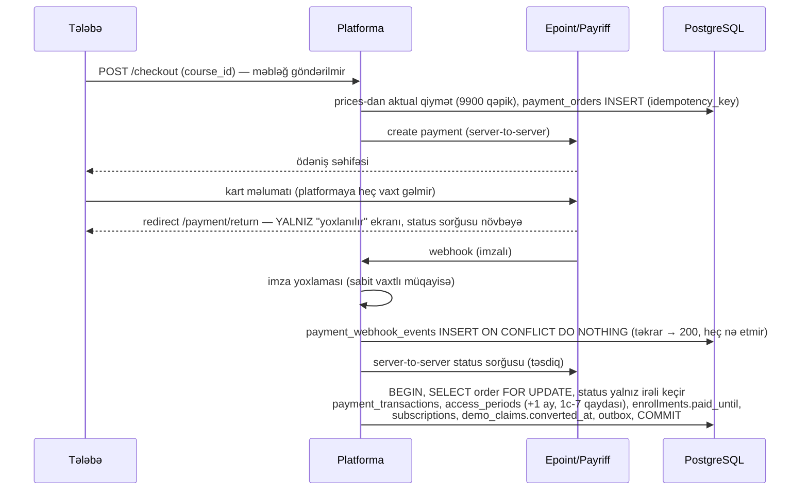

# Marketing School platforması — arxitektura təklifi (M0)

> Status: **təsdiq gözləyir**. Bu sənəd `docs/platform-prompt.md` (v2) bölmə 0.3-ə cavabdır.
> Təsdiqdən əvvəl böyük kod yazılmır. Bölmə 1b qərarları dəyişdirilmir; açıq məsələlər bölmə 9-dadır.

---

## 1. Hostinq cavabları və qəbul etdiyim fərziyyələr

| # | Sual (4.1) | Cavab / fərziyyə | Mənbə |
|---|---|---|---|
| 1 | Hostinq növü | **VPS** | sizin cavab |
| 2 | OS, runtime, SSH | Ubuntu 24.04 LTS, root SSH. Runtime-lar (PHP, PostgreSQL, ClamAV) **Docker konteynerlərindədir**, hostda yalnız Docker + Nginx | fərziyyə |
| 3 | Resurslar | **minimum 2 vCPU, 4 GB RAM, 60 GB NVMe**. 4 GB-ın səbəbi: ClamAV (`clamd`) imza bazası ilə ~1,2–1,5 GB RAM tutur. Bandwidth: video Bunny-dən gedir, tətbiq trafiki aylıq bir neçə GB-dır | fərziyyə + hesablama |
| 4 | Daimi proses, worker, cron | VPS-də var: `queue:work` daimi konteynerdə, planlayıcı (`schedule:work`) hər dəqiqə. Hostun cron-una ehtiyac yoxdur (yalnız backup üçün) | VPS |
| 5 | Docker, ffmpeg, ClamAV | Docker quraşdırılır; ClamAV rəsmi `clamav/clamav` konteynerində; **ffmpeg serverdə lazım deyil** (videonu Bunny kodlaşdırır) | VPS |
| 6 | SMTP | Provayder məlum deyil. **Adi SMTP hesabı, port 587** (VPS-lərdə 25 portu çox vaxt bağlıdır). Limit `.env`-də (`MAIL_MAX_PER_MINUTE`, default 20/dəq ≈ 1200/saat), prioritetli növbə. SPF/DKIM/DMARC domen DNS-ində qurulur | fərziyyə |
| 7 | Verilənlər bazası | **PostgreSQL 17** (konteyner), gündəlik şifrələnmiş `pg_dump` + restore testi | seçim |
| 8 | Domen | **`marketingschool.az/platform`**, Netlify proxy ilə (bölmə 2) | sizin cavab |
| 8b | Staging | `staging.marketingschool.az/platform`: eyni VPS-də ayrı Docker Compose layihəsi, ayrı DB, ayrı açarlar, ödəniş sandbox-u, HTTP Basic Auth arxasında | fərziyyə |
| 9 | Eyni anda izləyici | **100 tələbə** | sizin cavab |

**100 eyni vaxtlı tələbə üçün yük hesabı (yalnız tətbiq, video xaric):**

| Sorğu | Tezlik | 100 tələbədə |
|---|---|---|
| Progress heartbeat (hər 15 saniyədən bir) | 1 / 15 san | ~7 req/s |
| Video token yenilənməsi (TTL 10 dəqiqə) | 1 / ~8 dəq | ~0,2 req/s |
| Səhifə naviqasiyası | ~1 / 30 san | ~3 req/s |
| **Cəmi** | | **~10–15 req/s pik** |

2 vCPU-da PHP-FPM (~16 worker) bu yükü rahat daşıyır. M9-da `k6` ilə 100 virtual istifadəçi yük testi aparılır. Hədəf: origin-də p95 < 300 ms, xəta < 0,1%.

---

## 2. `/platform` yolu: Netlify proxy arxitekturası

Landing Netlify-da qalır və `marketingschool.az` DNS-i Netlify-a baxır. `/platform` yolunun VPS-ə çatmasının yeganə yolu **Netlify proxy (rewrite, status 200)** qaydasıdır.



`netlify.toml`-a əlavə olunur:

```toml
[[redirects]]
  from = "/platform/*"
  to = "https://origin.marketingschool.az/platform/:splat"
  status = 200
  force = true
  signed = "PLATFORM_PROXY_SECRET"   # Netlify hər proxy sorğusuna HS256 JWS (x-nf-sign) əlavə edir
```

**Bunun nəticələri (rəsmi Netlify sənədinə görə):**

| Fakt | Nə edirəm |
|---|---|
| Proxy timeout **26 saniyədir** | Heç bir sorğu uzun işləmir: PDF, e-mail, skan, import növbəyə gedir. Fayl yükləmə **5 MB-lıq hissələrlə (chunked)** aparılır. Video yükləmə Bunny-yə birbaşa **TUS** ilə gedir və proxy-dən keçmir |
| `netlify.toml` header-ləri proxy cavablarına tətbiq olunmur | CSP, HSTS və digər başlıqları **origin (Nginx/Laravel)** özü qaytarır |
| İmzalı proxy (`x-nf-sign`) | Origin `x-nf-sign` JWS-i yoxlamadan heç bir sorğunu qəbul etmir (health-check istisna). Kimsə VPS IP-sinə birbaşa gəlsə, 403 alır. Rate limit üçün müştəri IP-si yalnız imza etibarlıdırsa Netlify başlığından götürülür |
| Eyni origin (`marketingschool.az`) | **CORS lazım deyil**: demo forması eyni origin-ə POST edir (bölmə 2.12-dəki "CORS yalnız landing domeni" tələbi "CORS ümumiyyətlə açılmır" kimi sadələşir). Cookie: `__Secure-ms_session; Path=/platform; HttpOnly; Secure; SameSite=Lax` |
| Netlify proxy cavabları cache-ləyə bilər | Bütün dinamik cavablar `Cache-Control: private, no-store` ilə gəlir |

**Eyni origin-in təhlükəsizlik nəticəsi (açıq yazıram):** landing və platforma eyni origin-dədir. Landing-də (və ya `/admin`-dəki Decap CMS-də) XSS və ya kompromis olmuş xarici skript platformaya eyni origin hüququ ilə sorğu göndərə bilər. Cookie `HttpOnly` olsa da bu riski aradan qaldırmır. Bu, `app.` subdomeni ilə müqayisədə yeganə ciddi mənfi cəhətdir. Tədbirlər (M8/M9):
- `/admin/index.html` Decap skriptini hazırda `unpkg.com`-dan **SRI olmadan** yükləyir. Ya `integrity` hash əlavə olunur, ya da paket lokal build-ə daxil edilir;
- landing-ə ciddi CSP (`netlify.toml`): yalnız hash-lənmiş inline skript, `script-src 'self'`;
- platformada yüksək riskli əməliyyatlar (parol və e-mail dəyişmə, 2FA söndürmə, admin billing) əlavə olaraq **təkrar autentifikasiya** tələb edir.

Staging-də ilk iş real Netlify proxy testidir (cookie, `Set-Cookie`, 26 saniyə, upload). Problem çıxarsa ehtiyat variant `app.marketingschool.az` olar, amma bunu yalnız sizin razılığınızla edərəm.

---

## 3. Stack seçimi və əsaslandırma (4.2)

**Seçim: Laravel (PHP 8.4) + PostgreSQL 17 + Nginx + Docker Compose. UI: server-rendered Blade, minimal vanilla JS (Vite), player üçün hls.js.**

| Kriteriya | Laravel + PostgreSQL | Next.js + PostgreSQL |
|---|---|---|
| Queue, scheduler, mail, lokalizasiya, validasiya, rate limiter, CSRF, imzalı URL | **Hamısı daxildir, bir paketdə** | Hər biri ayrıca kitabxana (pg-boss, nodemailer, next-intl, csrf...) |
| Mərkəzi icazə qatı (policy/gate) | **Daxili Gate/Policy** | Özün qurmalısan |
| AI ilə uzunmüddətli dəstək | Çox geniş yayılmış, sabit konvensiyalar, yaxşı sənəd | App Router və server actions tez dəyişir |
| PostgreSQL RLS uyğunluğu | PHP-FPM: hər sorğu öz bağlantısı, `set_config` sızmır | Connection pool-da kontekst sızması riski, ORM-lə çətin |
| Lighthouse ≥ 90 | Server-rendered HTML, JS yalnız dərs səhifəsində | Hidrasiya yükü |
| Mənfi cəhət | Repoda ikinci dil (PHP), landing Node-da qalır | Tək dil |

**Monorepo quruluşu:**
```
/                     ← landing (Eleventy, Netlify): mövcud quruluş dəyişmir
/platform/            ← Laravel tətbiqi
  app/Domain/{Access,Billing,Content,Demo,Learning,Assessment,Live,Mentoring,Certificates,Notifications}
  app/Policies/       ← TƏK icazə qatı (AccessPolicy + resource policy-lər)
  app/Adapters/Video/{VideoProvider.php, BunnyStreamProvider.php, FakeVideoProvider.php}
  app/Adapters/Payment/{PaymentProvider.php, ManualProvider.php, EpointProvider.php|PayriffProvider.php, FakePaymentProvider.php}
  database/migrations, database/rls/   ← RLS policy-ləri ayrıca SQL miqrasiyaları
  lang/{az,en,ru}/
  tests/{Unit,Feature,Concurrency}/     ← Pest, real PostgreSQL üzərində
/e2e/                 ← Playwright (landing + platforma)
/deploy/              ← docker-compose.yml, nginx, backup skriptləri, staging/production .env.example
```

**Kitabxanalar** (hamısı açıq mənbəli və pulsuz, hər birinə `composer audit`/`npm audit`):
- `pragmarx/google2fa` (TOTP, MIT);
- `dompdf/dompdf` (diplom PDF-i, LGPL; Azərbaycan hərfləri üçün DejaVu Sans PDF-in içinə yerləşdirilir; UI-da xarici şrift yoxdur);
- `mews/purifier` / HTMLPurifier (tapşırıq cavablarının sanitizasiyası);
- `giggsey/libphonenumber-for-php` (E.164);
- `hls.js` (player);
- `xvo/clamav-client` və ya `clamd` INSTREAM protokolu üçün öz kiçik klientim.

**Konteynerlər:** `nginx`, `app` (php-fpm), `worker` (`queue:work`), `scheduler` (`schedule:work`), `postgres`, `clamav`. Redis yoxdur: queue, cache və rate limit PostgreSQL-dədir (100 tələbə üçün kifayətdir, bir xidmət azdır).

**Dizayn sistemi:** landing-in `style.css`-indən CSS dəyişənləri (`--brand`, `--brand-soft`, `--ink`, `--line`, `--r`...) `platform/resources/css/tokens.css`-ə **build zamanı kopyalanır** (tək mənbə: landing). Platformanın əlavə komponentləri yalnız bu dəyişənləri istifadə edir.

---

## 4. Verilənlər bazası: ERD

Prinsiplər:
- açarlar `bigint identity`, xaricə görünən ID-lər (diplom, fayl, sifariş) `uuid` və ya 128-bit random;
- bütün vaxtlar `timestamptz` (UTC); `Asia/Baku` yalnız hesablamada və göstərişdə;
- pul tam ədəd qəpiklə (`amount_qepik int`);
- çoxdilli məzmun sahələri `jsonb {az, en, ru}`. Videolar Azərbaycan dilindədir, mətnlər 3 dildə ola bilər.

### 4.1 Hesab və giriş



### 4.2 Məzmun və versiyalaşdırma

Modul, dərs və tapşırıq **daimi obyektlərdir**. Progress `lesson_id`-yə bağlıdır və versiyalar arasında itmir. **Kurs versiyası** isə hansı modul, dərs və tapşırıq revizyasının daxil olduğunu göstərən **manifestdir**. Enrollment versiyaya bağlanır: tamamlanma (100%) və diplom məxrəci həmin versiyanın manifestindən hesablanır. Dərsdə mətn düzəlişi və ya videonun yenidən yüklənməsi yeni `lesson_revision` yaradır, kurs versiyası dəyişmir. Struktur dəyişikliyi (yeni dərs, yeni məcburi tapşırıq, maksimum bal) isə yeni kurs versiyası yaradır, təsir görünüşü ilə birlikdə.



`recordings` (canlı görüş yazıları) `live_sessions.recording_video_asset_id` ilə eyni `video_assets` cədvəlindən istifadə edir və eyni token qorumasından keçir.

### 4.3 Giriş hüququ və billing



**Giriş statusunun hesablanması (tək funksiya, serverdə):** `AccessPolicy::status(enrollment, now)`:
- `canceled_at` varsa → `canceled`;
- `now <= paid_until` → `active`;
- `now <= paid_until + grace_period_days` → `past_due`;
- əks halda `expired`.

`paid_until` = ləğv edilməmiş `access_periods.ends_at`-ların maksimumu. Bu, refund (dövr `revoked_at` olur), ardıcıllıqdan kənar webhook və əl ilə aktivləşdirməni bir mexanizmlə həll edir. `status_cached` hər dəqiqə yenilənir və keçidlər (`past_due` başladı, `expired` oldu) bildiriş hadisəsi yaradır. Giriş qərarı isə həmişə canlı hesablanır.

### 4.4 Tədris, qiymətləndirmə, canlı, mentorluq, diplom

```mermaid
erDiagram
  users ||--o{ lesson_progress : has
  lessons ||--o{ lesson_progress : has
  users ||--o{ personal_notes : has
  users ||--o{ submissions : has
  assignments ||--o{ submissions : has
  submissions ||--o{ grades : "tarixçə"
  submissions ||--o{ uploaded_files : has
  courses ||--o{ live_sessions : has
  live_sessions ||--o{ live_questions : has
  live_sessions ||--o{ live_session_assignments : "müzakirə"
  courses ||--o{ mentor_slots : has
  mentor_slots ||--o{ mentor_bookings : has
  enrollments ||--o{ mentor_bookings : "1 hüquq"
  users ||--o{ certificates : has

  lesson_progress {
    bigint user_id FK "PK(user_id, lesson_id), idempotent upsert"
    bigint lesson_id FK
    int position_seconds
    int max_watched_seconds "GREATEST() ilə yalnız artır"
    numeric watch_percent
    timestamptz completed_at "yalnız 'Dərsi tamamladım'"
  }
  personal_notes {
    bigint id PK
    bigint user_id FK
    bigint lesson_id FK
    int at_second
    text body "plain text"
  }
  submissions {
    bigint id PK
    bigint user_id FK "UK(user_id, assignment_id)"
    bigint assignment_id FK
    bigint assignment_revision_id FK
    text status "submitted|reviewing|graded|needs_revision"
    text body_html "HTMLPurifier"
    timestamptz submitted_at
  }
  grades {
    bigint id PK
    bigint submission_id FK "partial UK WHERE superseded_at IS NULL"
    int points "CHECK 0..max_points_snapshot"
    int max_points_snapshot "dəyişməz"
    bigint graded_by FK
    text feedback
    timestamptz superseded_at
  }
  uploaded_files {
    uuid id PK
    bigint owner_user_id FK
    bigint course_id FK
    text purpose "submission|case_file|material"
    text storage_key UK "random, veb kökündən kənar"
    text original_name "yalnız metadata"
    text mime_detected
    bigint size_bytes
    text sha256
    text scan_status "pending|clean|infected|error"
    timestamptz quarantined_at
  }
  live_sessions {
    bigint id PK
    bigint course_id FK "UK(course_id, starts_at)"
    date occurrence_key "UK(course_id, occurrence_key): köçürülmüş görüş yenidən yaranmır"
    timestamptz starts_at
    text status "scheduled|canceled"
    bytea meeting_url_encrypted
    int ics_sequence
    uuid ics_uid UK
    bigint recording_video_asset_id FK
  }
  live_questions {
    bigint id PK
    bigint live_session_id FK
    bigint user_id FK
    text body
  }
  mentor_slots {
    bigint id PK
    bigint course_id FK
    bigint instructor_id FK
    tstzrange period "EXCLUDE USING gist (instructor_id WITH =, period WITH &&)"
    bytea meeting_url_encrypted
  }
  mentor_bookings {
    bigint id PK
    bigint slot_id FK "partial UK(slot_id) WHERE status='booked'"
    bigint enrollment_id FK "partial UK(enrollment_id) WHERE status IN ('booked','completed')"
    bigint user_id FK
    text status "booked|canceled|completed|no_show"
  }
  certificates {
    bigint id PK
    text verify_id UK "128-bit random, base32"
    bigint user_id FK "UK(user_id, course_id), hesab silinəndə NULL"
    bigint course_id FK
    jsonb snapshot "ad, kurs, təlimçi, bal, faiz, tarix — dəyişməz"
    timestamptz issued_at
    timestamptz revoked_at
    text revoke_reason
    bigint revoked_by FK
  }
```



### 4.5 Sistem



Əlavə köməkçi cədvəllər: `disposable_email_domains`, `player_metrics` (dərs üzrə, **user_id-siz**), `lesson_watch_buckets` (dərs və dəqiqə üzrə yığılmış abandonment), `video_token_log` (anomaliya aşkarlanması üçün; user_id, lesson_id, ip_hash, 90 gün saxlanılır), `settings_changes` (audit_logs-a yazılır).

### 4.6 PostgreSQL rolları və RLS

| Rol | Səlahiyyət | Harada |
|---|---|---|
| `ms_owner` | Sxemin sahibi, DDL. **Yalnız miqrasiya zamanı** | deploy addımı |
| `ms_app` | Yalnız DML, `NOBYPASSRLS`, sxem sahibi deyil, `audit_logs`-da yalnız `INSERT/SELECT` | `app` (veb) |
| `ms_worker` | `ms_app` kimi, ayrıca parol. RLS policy-lərində `current_user = 'ms_worker'` şərti ilə sistem işləri (bildiriş göndərmə, status yeniləmə) | `worker`, `scheduler` |

- Hər veb sorğusunun əvvəlində middleware `set_config('app.user_id', <id>, false)` çağırır. PHP-FPM bağlantıları persistent deyil, ona görə kontekst sorğular arasında sızmır (testlə yoxlanılır).
- Rol (admin, təlimçi) **app-dən ötürülmür**: policy-lər `app.is_admin()` və `app.teaches(course_id)` SECURITY DEFINER funksiyaları ilə `user_roles`/`course_instructors`-dan özü oxuyur.
- RLS cədvəlləri: `enrollments`, `lesson_progress`, `personal_notes`, `submissions`, `grades`, `uploaded_files`, `certificates`, `live_questions`, `mentor_bookings`, `demo_claims`, `notifications`, `user_sessions`, `access_periods`, `subscriptions`, `payment_orders`.
- Yazma vaxtı nümunəsi: `submissions` → `USING (user_id = app.uid() OR app.is_admin() OR app.teaches(course_of(assignment_id)) OR current_user='ms_worker')`.
- `audit_logs`: `UPDATE/DELETE` qadağandır (səlahiyyət + `BEFORE UPDATE OR DELETE` trigger, `ms_owner` üçün də).
- **RLS tətbiqdəki Policy qatını əvəz etmir.** Hər iki qat ayrı testlərlə yoxlanılır. RLS testlərində tətbiq yan keçilir və birbaşa `ms_app` ilə SQL işlədilir.

---

## 5. Auth axınları

### 5.1 Demo qeydiyyatı (landing forması → platforma)



**Qeyd (CSRF və enumeration):** demo endpoint-i landing-in statik formasından gəlir və CSRF token yoxdur. Qoruma: `Origin`/`Sec-Fetch-Site: same-origin` yoxlaması, honeypot, min. doldurma vaxtı və rate limit. Uğurlu və uğursuz cavab eynidir ("E-mailinizi yoxlayın"). Fərq yalnız e-mailin məzmunundadır, beləliklə hesabın mövcudluğu cavabdan bilinmir.

**Normallaşdırma:** e-mail: `trim` → kiçik hərf → hər domendə `+tag` silinir → `gmail.com`/`googlemail.com`-da nöqtələr silinir və domen `gmail.com`-a gətirilir. Telefon: `libphonenumber`, region `AZ` ilə: `050 123 45 67`, `0 50...`, `+994 50...`, `994501234567` → `+994501234567`. Etibarsız nömrə rədd edilir.

### 5.2 E-mail linki → parol → sessiya
1. Link: `/platform/{lang}/verify?t=<base64url 32 bayt>`. Serverdə `sha256(t)` axtarılır, `used_at`, `revoked_at` və `expires_at` yoxlanılır.
2. GET yalnız formanı göstərir. Token **POST** ilə (parol təyini) istehlak olunur, beləliklə e-mail skanerlərinin linki açması tokeni yandırmır.
3. Bir tranzaksiyada `email_verified_at`, `demo_claims.email_confirmed_at`, `password_hash` (argon2id) və `auth_tokens.used_at` yazılır, sonra yeni sessiya yaradılır (session rotation).
4. Resend: köhnə tokenlər `revoked_at` olur. Limit 3/saat/hesab. `demo_claims.expires_at` **dəyişmir**.
5. Demo bitibsə: e-mail təsdiqlənir, parol təyin olunur, istifadəçi "Kursu al" ekranına düşür.

### 5.3 Giriş, 2FA, sessiyalar
- E-mail + parol → argon2id yoxlaması (mövcud olmayan hesab üçün də sabit vaxtlı dummy hash).
- Admin və təlimçi üçün TOTP (RFC 6238, ±1 addım, eyni kod təkrar qəbul olunmur) və ya recovery code (10 ədəd, hash-lənmiş, birdəfəlik). 2FA quraşdırılmayıbsa, giriş yalnız quraşdırma ekranına yönləndirir.
- Hər girişdə və səlahiyyət dəyişəndə session ID yenilənir. Logout `user_sessions.revoked_at` yazır.
- **Sessiya limiti** (`billing_rules.session_limit`, default 2): 3-cü cihazdan giriş ən köhnə sessiyanı ləğv edir (default qayda, bölmə 9). Video tokeni yalnız etibarlı sessiyaya verilir.
- Parol bərpası: 1 saat ömürlü, birdəfəlik, hash-lənmiş token. İstifadədən sonra **bütün sessiyalar ləğv olunur**.
- Birbaşa alış (demosuz): `/platform/{lang}/register` (ad, e-mail, telefon) → təsdiq linki → parol → checkout. `demo_claim` yaranmır.

---

## 6. Billing axını



- **Status maşını** (`payment_orders.status`) yalnız irəli gedir: `created → pending → paid → refunded|charged_back`. "pending" "paid"-dən sonra gələrsə ignor olunur və log-a yazılır.
- **İki paralel webhook:** `FOR UPDATE` + `UNIQUE(provider_txn_id)` + `UNIQUE(transaction_id)` (access_periods-da), yalnız biri tətbiq olunur. Test: iki paralel PHP prosesi ilə.
- Webhook emalı uğursuz olarsa: `status=failed` olur, worker retry edir və admin paneldə görünür. "Checkout bağlanıb, ödəniş olub" halı: scheduler hər 5 dəqiqədə `pending` sifarişləri provayderdən soruşur.
- **Avtomatik renewal:** provayder kart tokenizasiyasını dəstəkləyirsə `next_charge_at`-da worker tokenlə çıxarış edir. Dəstəkləmirsə ehtiyat axın: `paid_until - 5 gün`-də ödəniş linki e-maili gedir. Hansının mümkün olduğu M6-nın ilk addımında rəsmi sənədlərdən müəyyən edilir (Epoint/Payriff müqayisə cədvəli).
- **Mərhələ 1 (M6a):** `ManualProvider`: admin `access_periods`-a əl ilə dövr əlavə edir (məcburi səbəb, audit). Biznes məntiqi eyni yoldan keçir.
- Demo → ödəniş: eyni `user_id` üçün `enrollments` UPSERT (`UNIQUE(user_id, course_id)`). Progress və qeydlər `user_id + lesson_id`-yə bağlıdır və enrollment-dən asılı deyil, ona görə avtomatik qorunur.

---

## 7. Video yanaşması (adapter qatı)

```php
interface VideoProvider {
  public function createUpload(string $title): UploadTicket;          // TUS endpoint + imza (admin brauzeri birbaşa Bunny-yə)
  public function playback(VideoAsset $v, PlaybackGrant $g): Playback;  // imzalı HLS URL + expires
  public function status(VideoAsset $v): VideoStatus;                   // processing|ready + müddət
  public function delete(VideoAsset $v): void;
}
```

Token axını: player → `POST /platform/api/lessons/{id}/playback` → `LessonAccessPolicy` (enrollment statusu, demo və 2 modul, sessiya etibarlılığı) → TTL = `min(10 dəq, demo_expires_at, grace_until)` → imzalı URL. Yeniləmədə eyni yoxlama təkrarlanır. İmtina olarsa player dayanır və "Kursu al" ekranı göstərilir.

**Bunny Stream: bildiklərim və yoxlanmalı olanlar.** `bunny.net` sənəd saytı bu sessiyanın şəbəkə siyasəti ilə bloklanıb; aşağıdakılar axtarış nəticələrindəki rəsmi sənəd parçalarına əsaslanır:
- iki token qatı var: **embed view token** (Bunny-nin iframe player-i üçün) və **CDN token authentication** (öz player-imiz üçün birbaşa HLS URL-ləri). HLS üçün seqmentlərin də imzalanması üçün **path-based token** tövsiyə olunur;
- **MediaCage Basic DRM** pulsuzdur və yükləmə cəhdlərini çətinləşdirir. Ayrıca **Enterprise DRM** (Widevine/FairPlay) var.
- **Açıq sual (M2-də yoxlanılacaq):** MediaCage Basic şifrələməsi öz hls.js player-imizlə işləyirmi, yoxsa yalnız Bunny embed player-i ilə? Bu vacibdir, çünki **dinamik watermark tam ekranda** yalnız öz player-imizdə etibarlı qalır (iframe-in öz tam ekranı overlay-i gizlədir). Seçim:
  - **(A, tövsiyə)** öz hls.js player-imiz + CDN path token + referer siyahısı + watermark. Basic DRM işləməsə seqmentlər şifrələnmir, amma qısa ömürlü və imzalı olur;
  - **(B)** Bunny embed + MediaCage Basic: şifrələmə var, amma watermark, fəsillər və progress inteqrasiyası zəifdir.

  Rəsmi sənəddən və real Bunny kitabxanasında testdən sonra qərarı sizə təqdim edəcəyəm. Enterprise DRM qiymətini də orada yazacağam.
- 1080p pillələri və 720p başlanğıc: hls.js-də `startLevel` və `capLevelToPlayerSize`, `Save-Data`/mobil şəbəkədə `autoLevelCapping=720p`. Bunny-də keyframe və bitrate-in nə qədər idarə olunduğu (bölmə 2.3b) M2-də yoxlanılır. Mümkün olmayanı açıq yazacağam.

---

## 8. Mərhələ planı (hostinq reallığına uyğunlaşdırılmış)

Hər mərhələ ayrıca branch-dadır: `m1-foundation`, `m2-content`, və s. Hər branch əvvəlkinin üzərində qurulur (stacked), `main`-ə commit yoxdur. Sonda bütün branch-lar tarixçə ilə zip-də veriləcək. GitHub-a push istəsəniz, eyni branch-lardan PR açılır.

| M | Məzmun | Hostinqə görə dəyişiklik | Qəbul |
|---|---|---|---|
| **M0** | Bu sənəd | — | sizin təsdiq |
| **M1** | Laravel skeleti, Docker Compose (6 konteyner), Nginx + `x-nf-sign` middleware, DB rolları + RLS infrastrukturu, dizayn tokenləri, 3 dilli UI skeleti, auth (təsdiq linki, parol, admin/təlimçi TOTP + recovery), sessiyalar və limit, rollar + Policy qatı, audit log (hash zənciri), outbox + notifications + worker, CI (Pest, Pint, Larastan, `composer/npm audit`, gitleaks, Semgrep, Dependabot) | Netlify proxy qaydası staging üçün; cookie `Path=/platform` | auth/icazə/RLS testləri |
| **M2** | Məzmun modeli + versiya manifesti, JSON import (idempotent) və landing export, `VideoProvider` + Bunny + Fake, TUS ilə birbaşa yükləmə, dərs səhifəsi (sol siyahı, video, tablar), hls.js player (watermark, sürət, qısayollar, fəsillər), progress (heartbeat + `sendBeacon`), "Dərsi tamamladım" | Bunny açarları olmadan Fake adapterlə test; real yoxlama sizin Bunny kitabxananızla | progress/tamamlanma testləri, import idempotent |
| **M3** | Demo axını (5.1–5.2), normallaşdırma, disposable siyahı, 24 saat, demo modulları, kilid ekranları, landing formunun inteqrasiyası (Netlify Forms çıxarılır), "Hər ikisi" seçiminin həlli | eyni origin: CORS yox, `Sec-Fetch-Site` yoxlaması | bölmə 7-dəki bütün demo testləri, paralel qeydiyyat |
| **M4** | Tapşırıqlar, chunked upload, magic bytes, OOXML zip-bomb/makro yoxlaması, **ClamAV + karantin** (EICAR testi), imzalı endirmə (`X-Accel-Redirect`), qiymətləndirmə, ballar, diplom (DECIMAL/tam ədəd), snapshot, dompdf PDF, `/platform/diplom/{id}` | ClamAV konteyneri (4 GB RAM şərti) | diplom sərhəd testləri, fayl testləri |
| **M5** | Canlı görüşlər (2-ci/4-cü şənbə 11:00 Baku, 3 ay qabaq, `occurrence_key`), `.ics` (SEQUENCE/CANCEL), xatırlatmalar, suallar, yazılar, mentor slotları (EXCLUDE constraint), atomik rezerv | scheduler konteyneri | cədvəl və race testləri |
| **M6** | Epoint/Payriff rəsmi sənəd müqayisəsi → seçim; `prices`, `billing_rules`, `access_periods`, statuslar, əl ilə aktivləşdirmə; provayder adapteri, webhook, lifecycle ssenariləri, demo→ödəniş | webhook Netlify proxy-dən keçir (26 san < emal, çünki emal sürətlidir və ağır iş növbədədir) | billing və keçid testləri |
| **M7** | Admin analitikası, admin panelin tamamlanması, bütün bildiriş hadisələri və 3 dilli şablonlar, player metrikləri | — | analitika və bildiriş testləri |
| **M8** | Landing: 99 AZN/ay, "2 həftədən bir" → "ayın 2-ci və 4-cü şənbəsi", 3 dil (`/en/`, `/ru/`), hreflang, sitemap, schema, `llms*.txt`, FAQ/bloq/CMS i18n, idempotent miqrasiya, Decap SRI, landing CSP, `/platform` robots-da bağlı | M1-dən sonra paralel gedə bilər | SEO və link testləri |
| **M9** | Security audit (`docs/security-audit.md`), düzəlişlər, k6 yük testi (100 VU), Lighthouse metodikası, şifrələnmiş backup + real restore testi, rollback planı, README, istehsala çıxış checklist | Real performans rəqəmləri yalnız real VPS + Bunny ilə ölçülür. Mən ölçmə skriptlərini və metodikanı verirəm, rəqəmləri "ödənilib" kimi yalnız real ölçmədən sonra yazıram | audit hesabatı və DoD |

**Bu sessiyada yoxlaya bilmədiklərim (açıq deyirəm):** real VPS-ə deploy, real Netlify proxy, real Bunny, Epoint/Payriff sandbox və real SMTP. Bunlar üçün adapterlər, Fake implementasiyalar və contract testləri yazılır. Real yoxlama siz açarları (`.env`) verəndə staging-də aparılır.

---

## 9. Hostinqə görə dəyişən tələblər və açıq qərarlar

### 9.1 Hostinqə görə dəyişən və ya dəqiqləşən tələblər
1. **CORS (2.12):** `/platform` eyni origin olduğu üçün CORS açılmır. Bunun əvəzinə `Origin`/`Sec-Fetch-Site` yoxlaması aparılır.
2. **Uzun sorğular:** 26 saniyəlik proxy limiti səbəbindən upload chunked aparılır, video yükləmə Bunny-yə birbaşa TUS ilə gedir, bütün ağır işlər növbədədir.
3. **Təhlükəsizlik başlıqları** origin-də qurulur (Netlify proxy cavablarına `netlify.toml` header-ləri tətbiq olunmur).
4. **Eyni origin riski:** Decap SRI və landing CSP M8-də, təkrar autentifikasiya M1-də. Hesabatda qalıq risk kimi yazılır.
5. **Worker və cron:** VPS-də mümkündür (konteynerlər), 1c-5 default-u (antivirus və worker olmadan istehsal yoxdur) **ödənilir**, ehtiyat axına ehtiyac yoxdur.
6. **ClamAV:** mümkündür, şərt **≥ 4 GB RAM**. 2 GB-lıq VPS-də ClamAV + PostgreSQL + PHP sabit işləməz.
7. **SMTP:** 587 portu, throttled prioritetli növbə (demo linki birinci).
8. **Staging eyni VPS-də:** resurs paylaşılır, ayrı DB, ayrı açarlar, ayrı `.env`, Basic Auth. Yükləmə testləri staging-də prod-a təsir edə bilər, ona görə yük testi pik saatdan kənarda aparılır.

### 9.2 Bölmə 1c: hazırkı default-lar (qərar verənə qədər qüvvədədir)
Hamısı `billing_rules` və ya konfiqurasiya kimi qurulur: 1) öhdəlik yoxdur; 2) `modules_completed_at` və `diploma_eligible_at` ayrı hadisələrdir; 3) avtomatik ödənişi yalnız tələbə və admin dayandırır; 4) qiymət verildikdən sonra `max_points` dəyişikliyi admin təsdiqi və səbəb tələb edir; 5) ödənilir (9.1-5); 6) refund olunan dövr ləğv edilir; 7) grace daxilində ödəniş köhnə `paid_until`-dən uzanır; 8) hər kursun ayrıca seriyası var; 9) CAPTCHA yoxdur.

### 9.3 Bölmə 1c-yə əlavə etməyi təklif etdiyim yeni məsələlər (default-larla)
| # | Məsələ | Təklif olunan default |
|---|---|---|
| 10 | Landing formasındakı **"Hər ikisi"** seçimi platforma üzrə bir demo qaydası ilə ziddiyyət təşkil edir | Demo formasından çıxarılır, istifadəçi bir kurs seçir |
| 11 | **Offsite backup yeri** (4.4: başqa xidmət üçün razılıq lazımdır) | Pulsuz variant: VPS provayderinin snapshot/backup funksiyası + həftəlik admin tərəfindən endirmə. Pullu alternativ: Bunny Storage (eyni Bunny hesabı, GB başına sent səviyyəsində) |
| 12 | Sessiya limiti dolanda 3-cü cihaz | Ən köhnə sessiya ləğv olunur və e-mail bildirişi gedir |
| 13 | 1:1 ləğv/köçürmə qaydası | Görüşdən 24 saat əvvələdək ləğv və köçürmə sərbəstdir, hüquq qayıdır. Gəlməmə (`no_show`) hüququ istifadə edir, admin bərpa edə bilər |
| 14 | Hesab silinəndə diplom (2.14 təsdiq tələb edir) | Açıq yoxlama qeydi qalır (yalnız snapshot: ad, kurs, tarix), `user_id` NULL olur, e-mail və telefon silinir |
| 15 | `grace_period_days` dəyişikliyi mövcud enrollment-lərə | Dərhal hamıya tətbiq olunur (canlı hesablanır), audit log-a yazılır |
| 16 | Fayl limitləri | Bir fayl 20 MB, tələbə və kurs üzrə 200 MB, tapşırıq üzrə 5 fayl |
| 17 | Demo istifadəçi **digər** kursu alsa | `converted_at` yalnız demo kursu alınanda yazılır; analitikada "digər kursa keçid" ayrıca sayılır |

---

## Mənbələr
- Netlify proxy, imzalı proxy, 26 saniyə timeout və proxy cavablarına header tətbiq olunmaması: [docs.netlify.com: Rewrites and proxies](https://docs.netlify.com/routing/redirects/rewrites-proxies/), [Netlify KB: netlify.toml redirects/headers](https://www.netlify.com/knowledge-base/how-to-configure-netlifytoml-redirects-headers-and-env-vars/)
- Bunny Stream token qatları və MediaCage: [docs.bunny.net: Stream security options](https://docs.bunny.net/stream/security-options), [support.bunny.net: Understanding Bunny Stream Security options](https://support.bunny.net/hc/en-us/articles/4414548058258) (bu sessiyada səhifələr açılmadı, axtarış nəticəsindəki parçalara əsaslanır; M2-də birbaşa yoxlanılacaq)
